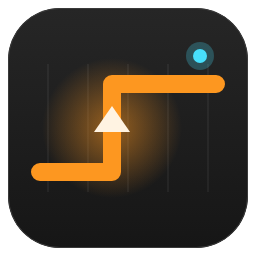
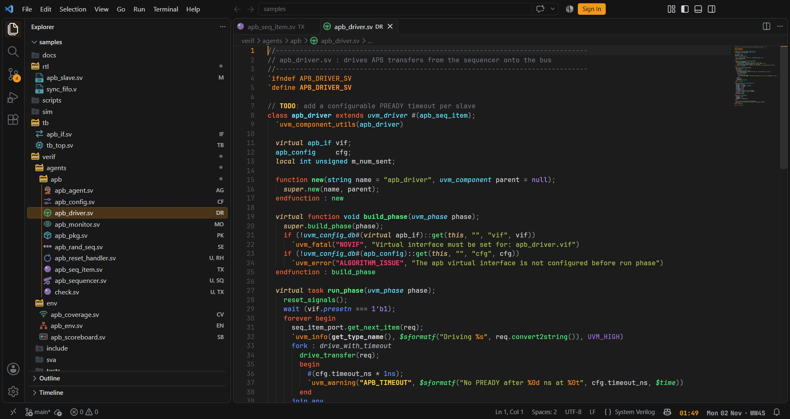
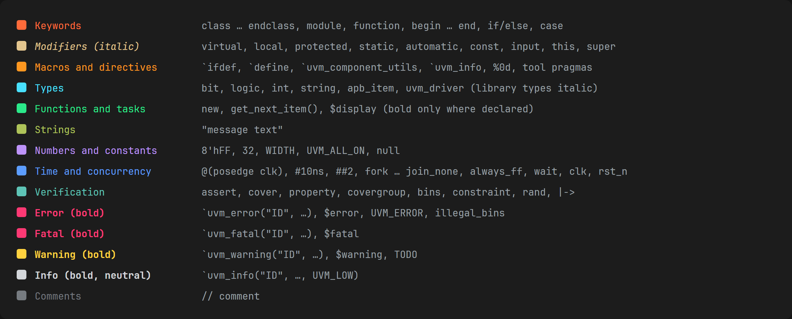
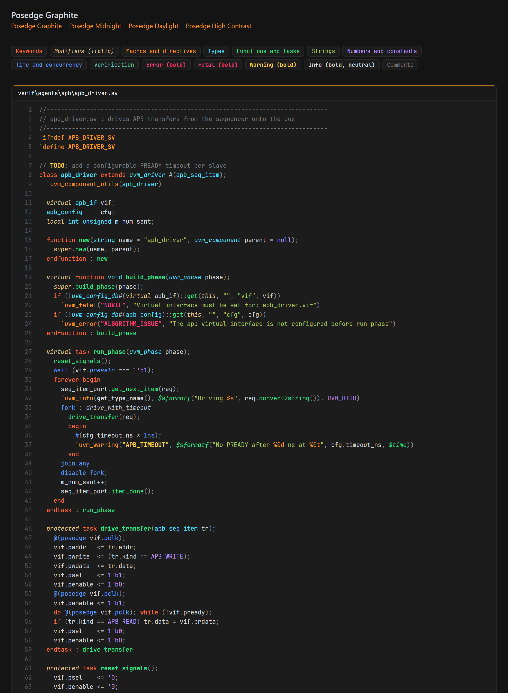
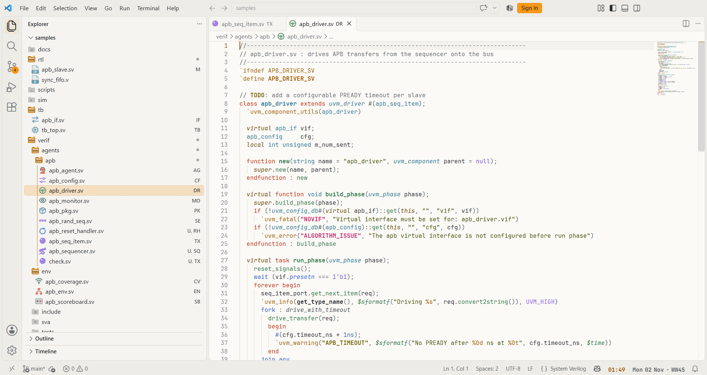
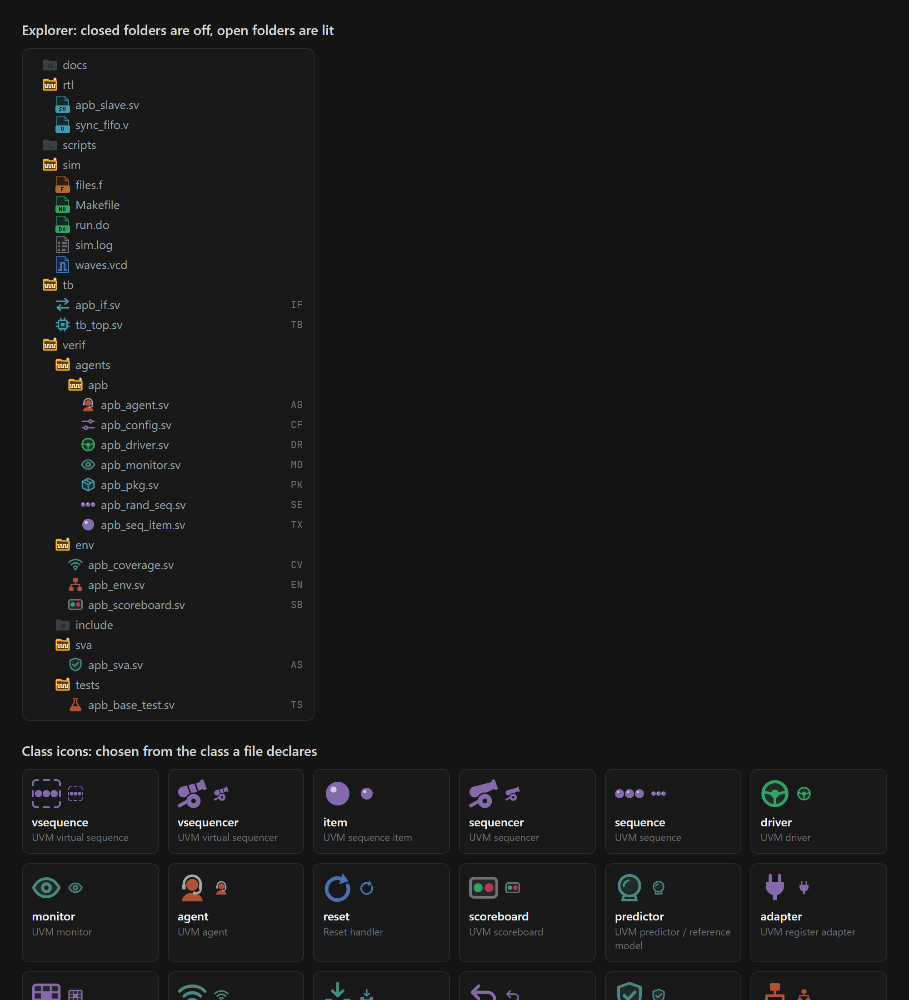
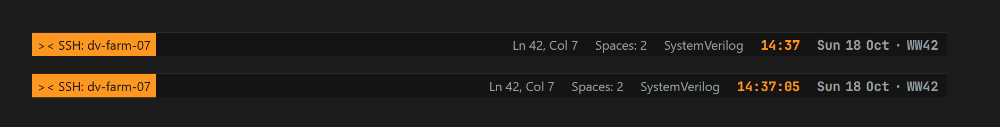

<p align="center"></p>

<h1 align="center">Posedge</h1>
<p align="center"><b>A color theme, file icon theme and JetBrains Mono clock for SystemVerilog &amp; UVM verification engineers.</b><br>
Every color means something. A keyword never changes color. Every macro shares one color.</p>
<p align="center">Designed by <b>Ahmed Khattab</b></p>



## Why Posedge

Most themes paint SystemVerilog by accident: `class` and `endclass` come out in different colors, `begin`/`end` change
color with nesting depth, `` `ifdef `` and `` `uvm_component_utils `` look unrelated, and a `` `uvm_error `` ID is just
another string. Posedge was built from the other end — from what a verification engineer needs to see:

- **One meaning per color.** Red and yellow appear in your code only when something *is* an error or a warning.
- **A keyword never changes color.** Posedge ships its own SystemVerilog/UVM lexer, so `class`, `endclass`, `begin` and `end`
  always resolve to the same color — in every context, at every nesting depth. This is enforced by automated tests.
- **Every macro shares one color.** `` `ifdef ``, `` `define ``, `` `uvm_component_utils ``, `` `uvm_info ``, `` `MY_MACRO `` — one color.
- **UVM semantics.** `` `uvm_error("ALGORITHM_ISSUE", "…") `` shows `ALGORITHM_ISSUE` in red; warnings are yellow, fatals red;
  the same ID is red again in the simulation log.

## The color language





| Color | Means | Examples |
|---|---|---|
| **Keywords** `#FF6B3A` | the skeleton of the code | `class … endclass`, `module`, `function`, `begin … end`, `if`, `case` |
| *Modifiers* | qualifiers | *`virtual`*, *`local`*, *`static`*, *`automatic`*, *`input`*, *`this`*, *`super`* |
| **Macros & directives** `#FD9720` | instructions to the preprocessor and tools | `` `ifdef ``, `` `uvm_info ``, `%0d`, `(* full_case *)`, `// synopsys translate_off` |
| **Types** `#48E0FD` | data types and classes | `bit`, `logic`, `string`, `apb_item`, *`uvm_driver`* (library types in italic) |
| **Functions & tasks** `#2BE98A` | behavior | `new`, `get_next_item()`, *`$display`*, **`build_phase`** (bold only where declared, plain where called) |
| **Strings** | text | `"message"` |
| **Numbers & constants** | values | `8'hFF`, `WIDTH`, `UVM_ALL_ON`, `null` — X/Z digits in red |
| **Time & concurrency** | when and in parallel | `@(posedge clk)`, `#10ns`, `##[1:3]`, `fork … join_none`, `always_ff`, `wait`, `clk`, *`rst_n`* |
| **Verification** | checks, coverage, stimulus | `assert`, `cover`, `property`, `covergroup`, `bins`, `constraint`, `rand`, `\|->` |
| **Error** (bold) | something is wrong | `` `uvm_error `` ID, `$error`, `UVM_ERROR`, `illegal_bins` |
| **Fatal** (bold) | it kills the simulation | `` `uvm_fatal `` ID, `$fatal` |
| **Warning** (bold) | look at this | `` `uvm_warning `` ID, `$warning`, `TODO` |
| **Info** (bold, neutral) | only problems get color | `` `uvm_info `` ID |
| **Comments** `#767B80` | | `// comment` |

**Bold** marks a declaration or a landmark, *italic* a qualifier or a library name. UVM verbosity fades with importance:
`UVM_NONE` stands out most, `UVM_DEBUG` least. Background `#1C1C1C` (Graphite), `#0F0F0F` (Midnight) or `#FBFAF7` (Daylight).
The hex values above are the dark palette.

## Daylight



For bright labs, projectors and printed code reviews. **Posedge Daylight** speaks the same color language on warm paper: every
hue stays in its family and is deepened until it reads at 4.5:1 or better, so you do not have to learn anything twice.

- **Warning is dark gold.** True yellow cannot be read on paper. Bold keeps it apart from the macro amber.
- **Comments keep `#696D70`**, which already clears 4.5:1 on paper.
- **The verbosity ramp runs the other way:** `UVM_NONE` is deepest and `UVM_DEBUG` faintest, because on paper more contrast means darker.
- **The accent splits in two.** `#FD9720` still fills buttons, badges and selected rows, while the cursor, focus rings and clock use a deeper `#9F5400`.
- **Lit folders adapt.** Posedge Icons ship a matching light set and VS Code switches to it by itself.

To follow your operating system between light and dark:

```jsonc
{
  "window.autoDetectColorScheme": true,
  "workbench.preferredDarkColorTheme": "Posedge Graphite",
  "workbench.preferredLightColorTheme": "Posedge Daylight"
}
```

## What's inside

| | |
|---|---|
| **Color themes** | **Posedge Graphite** (`#1C1C1C`, default) · **Posedge Midnight** (`#0F0F0F`) · **Posedge Daylight** (`#FBFAF7`, light) · **Posedge High Contrast** (WCAG AAA, every token ≥ 7:1) |
| **SystemVerilog / UVM lexer** | Applied on top of your SystemVerilog extension: consistent keywords, uniform macros, UVM report IDs, verbosity, phases, SVA, coverage bins, constraints, clocks and resets, X/Z digits |
| **Simulation logs** | `UVM_ERROR … [ID]` in the same red as in your code, `@ time` in blue, report summary (`UVM_ERROR : 0` is green, non-zero red), VCS / Questa / Xcelium / Verilator / Vivado messages, `TEST PASSED`/`FAILED` |
| **Filelists** | `+define+NAME` in the macro color, `+incdir+`, `-f`, `$VAR` |
| **File icon themes** | **Posedge Icons** — closed folders stay dark, open folders light up amber with a tiny clock running inside · **Posedge Icons (Still)** — same art, no motion |
| **Class icons** | A file's icon comes from the class inside it: `extends uvm_monitor` shows an eye, `extends uvm_driver` a steering wheel, through your own base classes too |
| **UVM role badges** | `DR` driver, `MO` monitor, `SB` scoreboard, `SE` sequence, `TX` item, `EN` env, `TS` test, … next to files in the Explorer |
| **Clock** | Time, date and work week in the status bar, drawn with **JetBrains Mono** |

## File icons



**Open folders light up; closed folders stay dark.** Every closed folder is the same flat gray silhouette with no color at
all, and only an open folder glows: a bright amber outline, lit from inside, with its LED on. So you can see at a glance
which folders are open. In *Posedge Icons* a clock trace runs inside the lit folder. Choose **Posedge Icons (Still)** for
remote desktops and VDI; the animation also stops when your OS asks for reduced motion. Tool-generated folders (`csrc`,
`xcelium.d`, `work`, `simv.daidir`, `obj_dir`, `sim_build`, …) are dimmer still when closed, so you know not to edit them.

File icons are deliberately quiet, so nothing at rest competes with a lit folder, but their colors speak the same language
as the code: cyan for HDL sources, teal for verification, blue for waves and timing, green for scripts and models, orange
for tool configuration, filelists and constraints, purple for data and registers, orange-red for netlists, physical and
FPGA files. With a light color theme both icon themes switch to a light set by themselves.

### Class icons

`.sv`, `.svh` and `.svi` files show what they *are*, read from the class they declare rather than from their name:

| Icon | Role | Icon | Role |
|---|---|---|---|
| Steering wheel | `uvm_driver` | Eye | `uvm_monitor` |
| Person with headset and mic | `uvm_agent` | Box with green and red lights | `uvm_scoreboard` |
| Wi-Fi signal | coverage (a class holding a `covergroup`) | Inbox | `uvm_subscriber` |
| Three small cannonballs side by side | `uvm_sequence` (dashed frame: virtual sequence) | Cannon | `uvm_sequencer` (dashed barrel: virtual sequencer) |
| One large cannonball | `uvm_sequence_item` | Sliders | configuration object |
| Hierarchy | `uvm_env` | Flask | `uvm_test` |
| Register map | `uvm_reg_block`, `uvm_reg` | Plug | `uvm_reg_adapter` |
| Crystal ball | `uvm_reg_predictor`, reference model | Curved arrow | `uvm_callback` |
| Shield | assertions, `checker` | Two opposite arrows | `interface` |
| Parcel | `package` | Chain link | bind file |
| Chip | testbench top | Hash | defines only |
| Arrow around a circle | reset handler | | |

The colors speak the same language: green drives stimulus, teal observes and checks, orange-red is structure, purple is
data and cyan connects to the design. Inheritance is followed across files, so `class fancy extends proj_base` is a driver
if `proj_base` extends `uvm_driver`. When a base class lives outside the workspace, the class name decides (`vip_mon`).
RTL modules keep their `SV` icon. Icons update about a second after you save.

VS Code icon themes map by file name, so two files with the same name share an icon. Files over 2 MB and folders of tool
output are skipped, and at most 5,000 files are scanned. Class icons require *Posedge Icons* or *Posedge Icons (Still)*;
turn them off with `posedge.explorer.classIcons`, and run **Posedge: Refresh Class Icons** after moving large trees.

## The clock



| Setting | Default | |
|---|---|---|
| `posedge.clock.timeFormat` | `{HH}:{mm}` | `{ss}` adds seconds; `{hh}` and `{A}` for 12-hour time; empty hides the time |
| `posedge.clock.dateFormat` | `{ddd} {DD} {MMM} · WW{WW}` | `{dddd}` `{D}` `{MMMM}` `{MM}` `{YYYY}` `{WW}` `{WD}` `{Q}` `{DOY}`; empty hides the date |
| `posedge.clock.workWeekStyle` | `iso` | `sunday` for Intel-style work weeks (WW01 contains January 1) |
| `posedge.clock.timeZones` | `[]` | tooltip rows for other sites, e.g. `[{ "label": "Austin", "timeZone": "America/Chicago" }]` |
| `posedge.clock.clickAction` | `copyTimestamp` | `toggleSeconds` or `none` |
| `posedge.clock.alignment` / `priority` | `right` / `-1000` | where it sits |
| `posedge.clock.useGlyphFont` | `true` | `false` uses the regular status bar font |

Commands: **Posedge: Copy Timestamp** (`2026-10-18 14:37:05`), **Posedge: Insert Timestamp**, **Posedge: Toggle Clock**,
**Posedge: Toggle Clock Seconds**. In Remote-SSH sessions the clock shows *your* local time.

## Install

1. Install **Posedge**:
   - **VS Code:** search for *Posedge* in the Extensions view, or run `code --install-extension ahmedkhattab.posedge`.
   - **Cursor, VSCodium, Windsurf and other editors that use Open VSX:** search for *Posedge* in the Extensions view.
   - **Offline:** download the `.vsix` from the [releases page](https://github.com/veriloger-khattab/posedge/releases) and
     run *Extensions: Install from VSIX...*
2. **Preferences: Color Theme** → *Posedge Graphite* (or Midnight / Daylight / High Contrast)
3. **Preferences: File Icon Theme** → *Posedge Icons*

Posedge colors any SystemVerilog extension's files, e.g. *Verilog-HDL/SystemVerilog/Bluespec* (mshr-h), *SystemVerilog*
(eirikpre) or TerosHDL. With language servers that provide semantic highlighting (Sigasi, DVT, slang) the same color
language is used for their tokens.

**Lite edition.** Companies that only allow code-free extensions can use the `posedge-lite` `.vsix` from the
[releases page](https://github.com/veriloger-khattab/posedge/releases): the color themes and icon themes without the lexer,
clock, class icons or badges (built with `npm run package:lite`).

### Recommended settings

```jsonc
{
  "editor.fontFamily": "'JetBrains Mono NL', 'JetBrains Mono', Consolas, monospace",
  "editor.fontSize": 13,
  "editor.lineHeight": 1.55,
  "editor.stickyScroll.enabled": true,
  "workbench.tree.renderIndentGuides": "always"
}
```

Use the **NL** (no ligatures) variant: in SystemVerilog `<=` is a non-blocking assignment, and a ligature would draw it as `≤`.

## Customization

Every Posedge token has a precise scope (run **Developer: Inspect Editor Tokens and Scopes**), so overrides are easy:

```jsonc
"editor.tokenColorCustomizations": {
  "[Posedge Graphite]": {
    "textMateRules": [
      // don't highlight clocks and resets by name
      { "scope": ["variable.other.clock.posedge", "variable.other.reset.posedge"], "settings": { "foreground": "#D4D7DB", "fontStyle": "" } },
      // a different macro color
      { "scope": "keyword.preprocessor.posedge", "settings": { "foreground": "#FFB454" } }
    ]
  }
}
```

**No rainbow.** `()`, `[]` and `{}` keep one color at every nesting depth, in every language: the themes give all six
depth levels the color of punctuation. A bracket with no partner still turns red, because that is an error. Posedge also
sets one default, for SystemVerilog and Verilog files only, that keeps keyword pairs such as `begin`/`end` out of bracket
coloring, so they keep their keyword color (that is why most themes show them in changing colors). Bracket matching
still works. To get a rainbow back, set your own colors:

```jsonc
"workbench.colorCustomizations": {
  "[Posedge Graphite]": {
    "editorBracketHighlight.foreground1": "#FFD700",
    "editorBracketHighlight.foreground2": "#DA70D6"
  }
}
```

## Privacy and security

- **No telemetry, no network access, no child processes, no webviews.** The runtime is 28 KB of readable, unminified
  JavaScript (`dist/extension.js`) with **zero dependencies**.
- **Class icons read your SystemVerilog files as plain text** and record only file names and role names in Posedge's own
  icon theme files, inside its extension folder, with a copy in VS Code's extension state so they survive updates.
  Nothing is written to your workspace. Turn this off with `posedge.explorer.classIcons`, or use the code-free Lite
  edition.
- Apart from that, it writes only its own settings (`posedge.*`), and only when you run one of its toggle commands.
- Works in untrusted workspaces, virtual workspaces, Remote-SSH, WSL, Dev Containers, Codespaces and code-server.
- See [SECURITY.md](SECURITY.md).

## FAQ

**Why are clocks and resets blue?** Blue means *time*: `@`, `#`, `##`, `posedge`, `fork`, `always_ff`. Signals named like
clocks (`clk`, `pclk`, `sys_clk`) and resets (`rst_n`, `presetn`, `rst_ni`, italic) belong to that family. Calls such as
`reset_signals()` are not affected.

**A keyword has a different color in my editor.** A language server's semantic tokens can override the lexer. Check with
*Developer: Inspect Editor Tokens and Scopes*, and try `"editor.semanticHighlighting.enabled": false`.

**A word inside a string turns red after VS Code starts.** With a file restored from your last session, VS Code's
background tokenizer can treat a word such as `interface` as an unmatched bracket, with any theme. Setting
`"editor.experimental.asyncTokenization": false` stops it, but applies to every language, and very large files may then
feel less smooth. It is your choice, so Posedge leaves that setting alone.

**Do class icons load slowly?** Normally they appear with the Explorer's first frame. After an update, or in a project
opened for the first time, `.sv` files show a generic icon for a couple of seconds, because VS Code draws the Explorer
before any extension can run.

**Does the folder animation cost performance?** Only open folders animate, one pixel step at about five frames per
second, with no filters. *Posedge Icons (Still)* has no motion at all.

**Can the icons be bigger?** Posedge already uses nearly all the room there is: VS Code draws file icons 16 px wide, and an
icon theme cannot change that. **Can Posedge set the Explorer's font?** No: VS Code has no setting or extension API for it.

## Contributing

Everything visual is generated from data in `design/` — palette, roles, keyword families, UVM vocabulary, icon registry.
See [CONTRIBUTING.md](CONTRIBUTING.md). `npm test` checks the three rules above against real files with VS Code's own
TextMate engine.

## Credits

Posedge was designed and built by **Ahmed Khattab**. Questions, ideas and bug reports are welcome on the
[issue tracker](https://github.com/veriloger-khattab/posedge/issues).

## License

[MIT](LICENSE) © Ahmed Khattab. The clock glyphs are derived from [JetBrains Mono](https://github.com/JetBrains/JetBrainsMono) and are
licensed under the [SIL Open Font License 1.1](fonts/OFL.txt).
